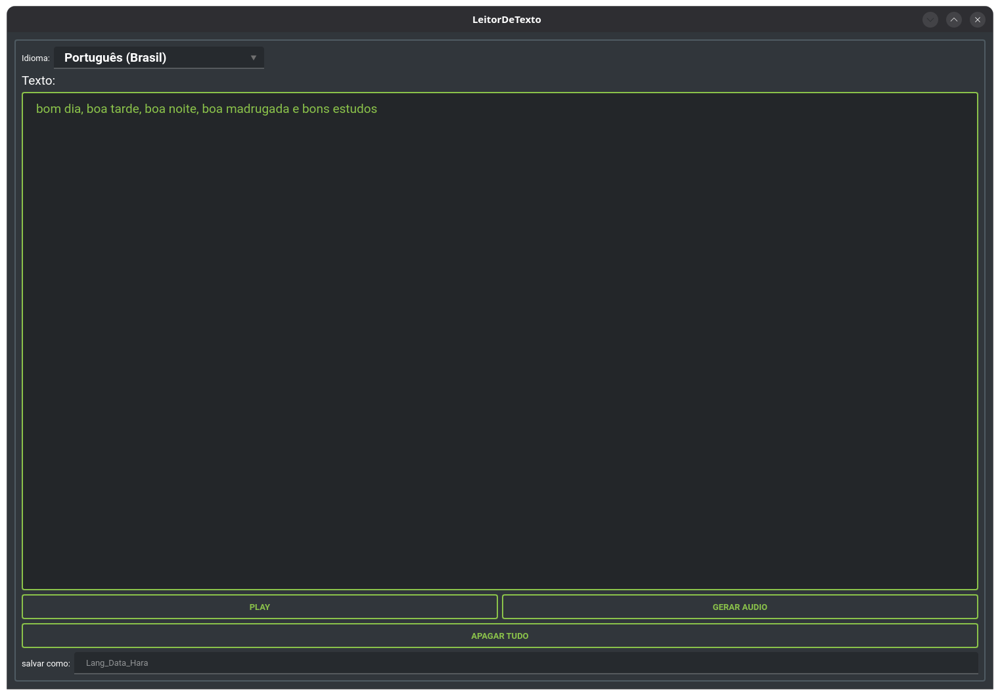

# Leitor de Texto

Aplicativo desktop para transformar textos em áudio. Escreva ou cole um texto, escolha o idioma e gere um arquivo MP3 para ouvir.

## Captura de tela

Adicione uma imagem do aplicativo e atualize o caminho abaixo:



## Requisitos

- Python 3
- Conexão com a internet para gerar o áudio (o aplicativo usa o Google Text-to-Speech)

## Instalação

1. Clone este repositório e entre na pasta do projeto:

   ```bash
   git clone https://github.com/jonasht/leitorTexto.git
   cd leitorTexto
   ```

2. Crie e ative um ambiente virtual (recomendado).

   **Linux/macOS:**

   ```bash
   python3 -m venv .venv
   source .venv/bin/activate
   ```

   **Windows (PowerShell):**

   ```powershell
   python -m venv .venv
   .venv\Scripts\Activate.ps1
   ```

3. Instale as dependências:

   ```bash
   python -m pip install -r requirements.txt
   ```

## Como executar

Com o ambiente virtual ativado, execute na pasta do projeto:

```bash
python main.py
```

Digite ou cole o texto, selecione o idioma e clique em **Gerar Audio**. O arquivo MP3 será salvo na pasta do projeto. Use **Play** para ouvi-lo; o campo “salvar como” permite definir o nome do arquivo.
